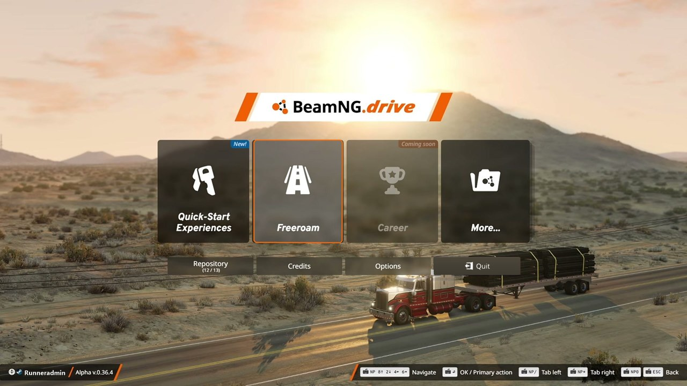
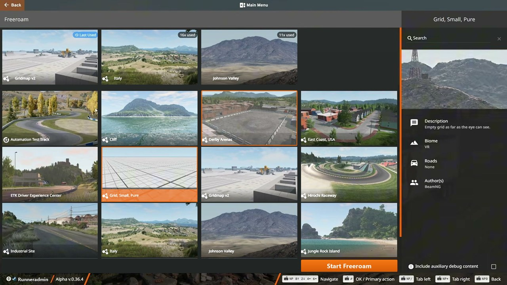
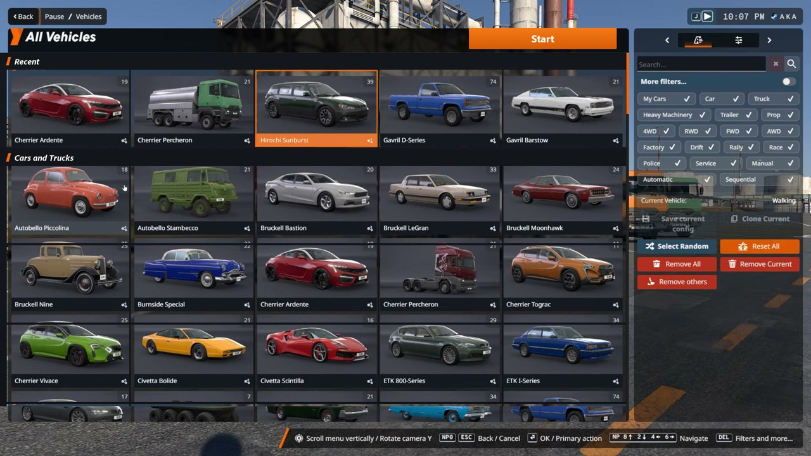
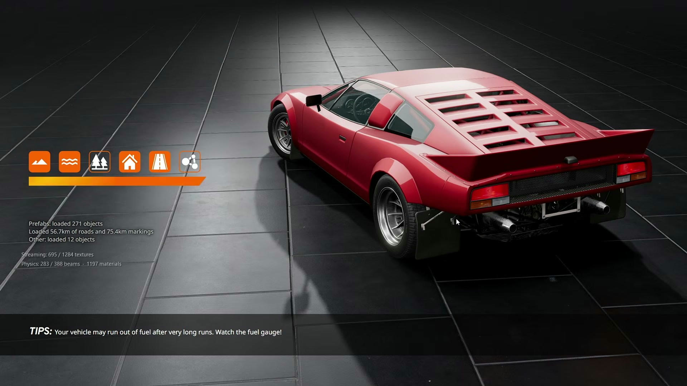
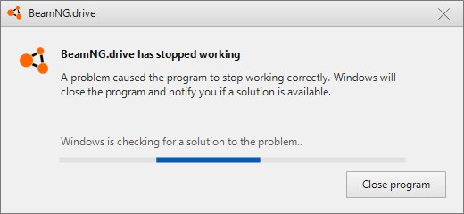
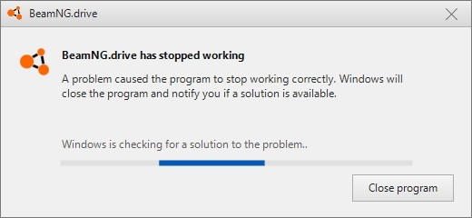
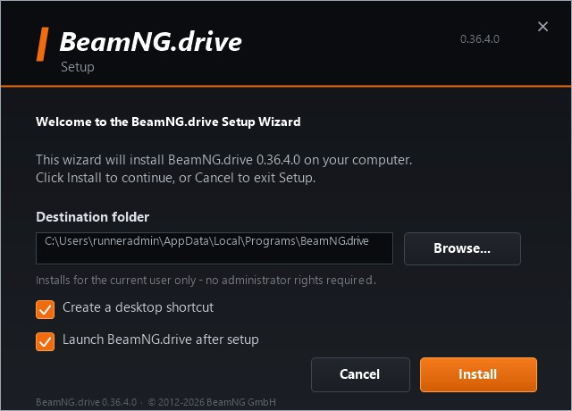

<p align="center">
  
</p>

<h1 align="center">BeamNG.drive — Launcher Prank</h1>

<p align="center">
  <b>Один exe. Полный запуск BeamNG.drive. И краш на загрузке.</b><br>
  Шутка для друга, который очень ждал «поиграть».
</p>

<p align="center">
  <a href="../../actions/workflows/build.yml"></a>
  
  
  
  
</p>

---

## Что это

Приложение выглядит и ведёт себя как настоящий лаунчер BeamNG.drive: главное меню, выбор карты,
выбор машины, экран загрузки с реальной анимацией — а на финале игра «падает»
с системным окном. Причём падает по-разному и оставляет после себя настоящие на вид `beamng.log`
и `beamng_dump.dmp`.

Никакой игры внутри нет: это 4.2 МБ, один файл, без зависимостей. Плюс отдельный установщик,
если хочется, чтобы всё выглядело совсем серьёзно.

## Экраны

| Главное меню | Выбор карты |
|---|---|
|  |  |

| Выбор машины | Экран загрузки |
|---|---|
|  |  |

| «Краш» — Windows 10/11 | «Краш» — Windows 7/8 |
|---|---|
|  |  |

<p align="center">
  
</p>

## Фичи

- **1:1 с оригиналом.** Фоны, карточки, иконки и шрифты сняты с реальных кадров игры (1920×1080),
  интерфейс дорисовывается кодом — ховеры, выделение, скролл, кнопки.
- **Живое меню.** Подсветка карточек, рабочая кнопка `Quit`, вкладки `Repository` / `Credits` / `Options`
  открывают правдоподобные страницы. `Career` — серая заглушка «Coming soon».
- **Два пути.** `Freeroam` → выбор карты и машины → загрузка. `Quick-Start Experiences` → сценарии →
  та же загрузка.
- **Настоящая анимация загрузки.** 79 реальных кадров из игры, 20 fps, поверх статичного фона — не
  перерисованная в коде имитация. Живые счётчики текстур, материалов и физики тикают по ходу загрузки.
- **Выбор машины как в игре.** 5 колонок, 30 слотов, 20 уникальных карточек, оранжевая плашка с белым
  текстом у выбранной, прокрутка колесом.
- **Подмена имени.** Вместо ника стримера подставляется имя учётной записи Windows, с которой запущен exe.
- **Свой курсор.** Оранжевая стрелка в стиле игры рисуется прямо в кадре; системный курсор скрыт.
- **Финал.** На завершении загрузки картинка замирает, поверх всплывает диалог краша. Стиль окна
  подстраивается под ОС: классический Windows 7/8 или плоский Windows 10/11.
- **Четыре варианта краша.** `has stopped working`, `is not responding`, `unable to start correctly
  (0xc000007b)` и `Display driver stopped responding`. Первый запуск всегда показывает классический
  диалог, дальше варианты меняются — повторный запуск перестаёт быть предсказуемым.
- **Следы катастрофы.** После краша рядом с exe появляются `beamng.log` с `DX11: device removed`,
  `beamng_dump.dmp` с заголовком `MDMP` и `crash-info.txt` с версией, ОС и временем.
- **Alt+F4 во время загрузки** = мгновенный краш, как у настоящей игры. Второй клик по exe пишет
  «BeamNG.drive is already running».
- **Установщик.** `BeamNG.drive_Setup.exe` с тёмным визардом, установкой в `%LOCALAPPDATA%\Programs`,
  ярлыками на рабочем столе и в меню «Пуск», записью в «Программы и компоненты» и рабочим удалением.
- **Windows 7+.** .NET Framework 4.5.2, GDI+, без GPU-зависимостей.
- **Самопроверка.** `--selftest <dir>` рендерит 20+ экранов в PNG — этим пользуется CI, чтобы ловить
  визуальные регрессии. Установщик умеет `--shot <dir>`, а `--video <dir>` рендерит покадровую демку
  всего сценария с курсором, из которой CI собирает mp4.

## Скачать

Готовый архив: **[Releases](../../releases/latest)**.

Демо всего сценария (~18 секунд, с курсором): **[beamng-prank-demo.mp4](../../releases/latest/download/beamng-prank-demo.mp4)**.

```
BeamNG-drive-win.zip
├── BeamNG.drive.exe          (4.2 MB)  — сама «игра»
└── BeamNG.drive_Setup.exe    (4.3 MB)  — установщик
```

Можно запустить `BeamNG.drive.exe` сразу или поставить через `BeamNG.drive_Setup.exe`
(появится ярлык на рабочем столе и запись в «Программах и компонентах»).

## Управление

| Действие | Как |
|---|---|
| Навигация | мышь |
| Прокрутка карт и машин | колесо мыши |
| Назад | `Esc` или кнопка `Back` |
| Подтвердить | `Enter` / клик |
| Мгновенный краш | `Alt+F4` во время загрузки |

## Как это устроено

- **Ассеты** — кадры из игры, нарезанные офлайн-скриптом (`tools/build_assets.py`): фоны экранов,
  20 карточек машин, 15 карт, маски подписей, 79 кадров загрузки, иконка. Всё вшито в exe как ресурсы.
- **UI** — C# WinForms, GDI+. Сцена рисуется в DIB-секцию 1920×1080 и выводится на экран нативным
  `StretchBlt`, поэтому ховеры и переходы не зависят от скорости `Graphics.DrawImage`.
- **Анимации** — на реальном времени (Stopwatch), а не на количестве кадров: одинаково плавно на любом FPS.
- **Краши** — номер запуска хранится в `%LOCALAPPDATA%\BeamNG.drive\launches.dat`; по нему выбирается
  вариант диалога. Лог, дамп и `crash-info.txt` пишутся рядом с exe (или в `%LOCALAPPDATA%`, если папка
  только для чтения).
- **Установщик** — отдельный exe с игрой внутри: распаковывает её, создаёт ярлыки через `WScript.Shell`
  и пишет ключ удаления в HKCU.
- **CI** — GitHub Actions собирает оба exe, прогоняет `--selftest` (20+ рендеров, проверка вывода на
  экран, проверка лога/дампа), рендерит установщик и публикует артефакты.

## Сборка

```bash
# Windows, MSBuild 2019+
msbuild src/BeamPrank.csproj /restore /p:Configuration=Release
msbuild src/Installer/BeamSetup.csproj /restore /p:Configuration=Release
```

Установщик встраивает `src/bin/Release/BeamNG.drive.exe`, поэтому сначала собирается игра.
Или просто пуш в `main` — workflow `.github/workflows/build.yml` соберёт всё сам.

## Дисклеймер

Фан-проект, не связан с BeamNG GmbH. Все игровые изображения и логотипы принадлежат их правообладателям;
проект сделан как безобидная шутка и не распространяется как игра. Не запускайте на чужих рабочих
машинах без разрешения — «краш» выглядит убедительно.
