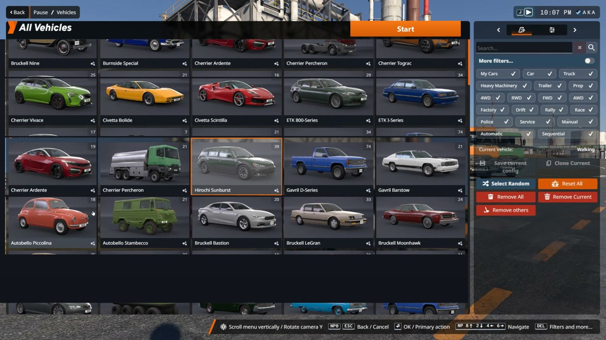

<p align="center">
  
</p>

<h1 align="center">BeamNG.drive — Launcher Prank</h1>

<p align="center">
  <b>Один exe. Полный запуск BeamNG.drive. И краш на загрузке.</b><br>
  Шутка для друга, который очень ждал «поиграть».
</p>

<p align="center">
  <a href="../../actions/workflows/build.yml"></a>
  
  
  
  
</p>

---

## Что это

Приложение выглядит и ведёт себя как настоящий лаунчер BeamNG.drive: главное меню, выбор карты,
выбор машины, экран загрузки с реальной анимацией — а на финале игра «падает» с системным окном
`BeamNG.drive has stopped working`.

Никакой игры внутри нет: это 4.2 МБ, один файл, без установки и зависимостей.

## Экраны

| Главное меню | Выбор карты |
|---|---|
|  |  |

| Выбор машины | Прокрутка списка |
|---|---|
|  |  |

| Загрузка | «Краш» |
|---|---|
|  |  |

## Фичи

- **1:1 с оригиналом.** Фоны, карточки и шрифты сняты с реальных кадров игры (1920×1080), интерфейс
  дорисовывается кодом — ховеры, выделение, скролл, кнопки.
- **Живое меню.** Подсветка карточек, рабочая кнопка `Quit`, вкладки `Repository` / `Credits` / `Options`
  открывают правдоподобные страницы. `Career` — серый заглушка-«Coming soon».
- **Два пути.** `Freeroam` → выбор карты и машины → загрузка. `Quick-Start Experiences` → сценарии →
  та же загрузка.
- **Настоящая анимация загрузки.** 79 реальных кадров из игры, 20 fps, поверх статичного фона — не
  перерисованная в коде имитация.
- **Выбор машины как в игре.** 5 колонок, 30 слотов, 20 уникальных карточек, оранжевая плашка с белым
  текстом у выбранной, прокрутка колесом.
- **Подмена имени.** Вместо ника стримера подставляется имя учётной записи Windows, с которым запущен exe.
- **Финал.** На завершении загрузки картинка замирает, поверх всплывает окно «BeamNG.drive has stopped
  working» в стиле Windows 7/10 — с прогресс-баром «Windows is checking for a solution…».
- **Windows 7+.** .NET Framework 4.5.2, GDI+, без GPU-зависимостей.
- **Самопроверка.** `--selftest <dir>` рендерит все 13 экранов в PNG — этим пользуется CI, чтобы ловить
  визуальные регрессии.

## Скачать

Готовый архив с exe: **[Releases](../../releases/latest)**.

```
BeamNG-drive-win.zip
└── BeamNG.drive.exe   (4.2 MB)
```

Распаковать в любую папку и запустить. Установка не нужна.

## Управление

| Действие | Как |
|---|---|
| Навигация | мышь |
| Прокрутка карт и машин | колесо мыши |
| Назад | `Esc` или кнопка `Back` |
| Подтвердить | `Enter` / клик |

## Как это устроено

- **Ассеты** — кадры из игры, нарезанные офлайн-скриптом (`tools/build_assets.py`): фоны экранов,
  20 карточек машин, 15 карт, маски подписей, 79 кадров загрузки, иконка. Всё вшито в exe как ресурсы.
- **UI** — C# WinForms, GDI+. Сцена рисуется в DIB-секцию 1920×1080 и выводится на экран нативным
  `StretchBlt`, поэтому ховеры и переходы не зависят от скорости `Graphics.DrawImage`.
- **Анимации** — на реальном времени (Stopwatch), а не на количестве кадров: одинаково плавно на любом FPS.
- **CI** — GitHub Actions собирает exe, прогоняет `--selftest` (13 рендеров + проверка вывода на экран),
  публикует артефакты и релиз.

## Сборка

```bash
# Windows, MSBuild 2019+
msbuild src/BeamPrank.csproj /restore /p:Configuration=Release
```

Или просто пуш в `main` — workflow `.github/workflows/build.yml` соберёт всё сам.

## Дисклеймер

Фан-проект, не связан с BeamNG GmbH. Все игровые изображения и логотипы принадлежат их правообладателям;
проект сделан как безобидная шутка и не распространяется как игра. Не запускайте на чужих рабочих
машинах без разрешения — «краш» выглядит убедительно.
